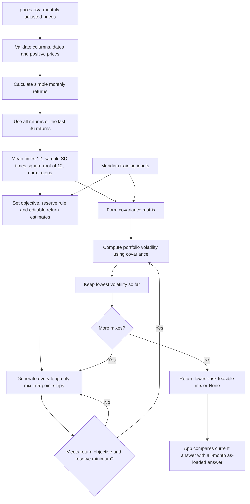

# Lab 15 — Portfolio Stability Decision

Eleanor Madden | October 22, 2026

## D — Define

Which mix carries the least risk while meeting the mandate, and does the answer survive a one-point change in one estimate?

For my draft Project 2 mandate, the all-month answer is **60% BIL and 40% VT**. Reducing VT's return estimate by one percentage point moves 5 points from BIL to VT. Changing the estimation window moves 25 points, so I would pilot this allocation before adopting it.

## R — Represent my universe and mandate

My [Project 2 mandate](PROJECT2-MANDATE.md) is a draft based on the fund universe already prepared in Lab 14. I chose a fictional scholarship foundation with a seven-year horizon. The numerical objective is **6.5%**, from CPI + 4% using a 2.5% CPI estimate. The hard reserve rule is **at least 3% in BIL and IEF**, from 4 × $0.75 million / $100 million. The search also requires nonnegative weights summing to 100%. I keep these requirements unchanged in every run.

This is my explanation to give my partner: BIL covers cash and reserve, IEF adds government bonds, LQD adds corporate bonds, and VT adds global stocks. I want the lowest estimated volatility among five-point mixes that clear the return and reserve screens.

### Data and sources

[prices.csv](prices.csv) is preserved from my local Lab 14 work. It contains 60 monthly adjusted prices, October 2021–September 2026, in USD, oldest month first. Dates label months rather than trading-day observations. October 2026 is incomplete and excluded. Sixty prices produce **59 monthly returns**, November 2021–September 2026. The last-36 calculation uses October 2023–September 2026 returns, retaining September 2023's price to calculate the first return.

| Ticker | Fund and role | Source | Download date (UTC) |
|---|---|---|---|
| BIL | State Street SPDR Bloomberg 1–3 Month T-Bill ETF; cash and reserve | [Yahoo monthly Adj Close](https://finance.yahoo.com/quote/BIL/history/) | 2026-10-20 |
| IEF | iShares 7–10 Year Treasury Bond ETF; government bonds and eligible reserve | [Yahoo monthly Adj Close](https://finance.yahoo.com/quote/IEF/history/) | 2026-10-20 |
| LQD | iShares iBoxx $ Investment Grade Corporate Bond ETF; corporate fixed income | [Yahoo monthly Adj Close](https://finance.yahoo.com/quote/LQD/history/) | 2026-10-20 |
| VT | Vanguard Total World Stock Index Fund ETF; global equity | [Yahoo monthly Adj Close](https://finance.yahoo.com/quote/VT/history/) | 2026-10-20 |

The original [download log](data/price_download.txt) records the exact endpoints and timestamp, **2026-10-20T20:05:04 UTC**. The unmodified Yahoo responses are in [data/](data/); [download_prices.py](download_prices.py) documents retrieval. Validation matches every submitted price to those saved responses. Re-downloading can change historical adjusted prices, so the submitted CSV and raw responses are the reproducible snapshot.

### Estimation method

Monthly simple return = current adjusted price / previous adjusted price − 1. Annual return **estimate** = monthly arithmetic mean × 12. Annual volatility **estimate** = sample standard deviation × √12. Correlations use the same monthly return window for every fund. Covariance = correlation × annual volatility of each asset. This follows the course handout; it is not CAGR. Annual risk scaling assumes independent monthly returns, and a historical average is not a forecast.

| Asset | All-month return estimate | All-month volatility estimate | Last-36 return estimate | Last-36 volatility estimate |
|---|---:|---:|---:|---:|
| BIL | 3.66% | 0.49% | 4.37% | 0.21% |
| IEF | -1.73% | 7.72% | 3.07% | 6.66% |
| LQD | -0.93% | 9.87% | 4.84% | 7.82% |
| VT | 11.05% | 14.92% | 20.25% | 11.71% |

Full-precision estimates and correlation tables are in [outputs/](outputs/). For example, IEF–LQD correlation is 0.9348 on all months and 0.9356 on the last 36. These funds have substantial shared interest-rate exposure.

## I — Implement

My original Lab 14 files are unchanged. This folder's [portfolio.py](portfolio.py) builds on the identical engine in my [Lab 14 repository](https://github.com/eleanorjanemadden/Lab-14). It adds `search_portfolio` and `estimate_from_csv` while preserving the existing printed output byte for byte. The search evaluates every fully invested long-only five-point mix, filters by return and reserve, and keeps the lowest volatility. With four assets there are 1,771 possible mixes. An infeasible search returns `None`.

[app.py](app.py) imports the training inputs and calculations from that engine. It has the objective and reserve controls, CSV upload, last-36 switch, editable annual returns, and eligibility boxes. Current and as-loaded answers appear side by side, with weights, return, volatility, reserve, and largest absolute weight change. For a CSV the reference always uses all months and initial eligibility; both columns use the current sidebar objective and minimum. There is also a convenience box to load the included CSV without uploading it.

### Engine flowchart

This AI-generated chart is included for review. 

### Explain the search — preparation for my own explanation

1. `n` counts assets; the first checks require three to six assets, matching lengths, finite returns, and a valid reserve minimum.
2. `covariance_matrix` validates the risk inputs and forms covariance once.
3. `mixes(remaining, slots)` divides 20 integer units across the assets. Each unit is five percentage points.
4. If only one slot remains, it receives all leftover units. Otherwise the loop tries zero through every remaining unit for the next asset, then recursively divides what is left.
5. `best = None` means no feasible mix has been found yet.
6. For each mix, `expected_return` computes the weighted return and `reserve_weight` adds the eligible weights.
7. `continue` skips mixes below either minimum. The tiny tolerance only handles numerical rounding.
8. `portfolio_volatility` uses all covariance pairs to calculate risk.
9. If this is the first feasible mix or has lower volatility, the dictionary becomes `best`. Ties retain the first mix generated.
10. After every mix has been tried, `return best` gives the answer or `None`.

**Partner question:** Why does a 3% reserve minimum sometimes produce at least 5% reserve? 
**Answer:** Weights change in five-point steps, so 3% cannot be represented exactly. The search uses the first allowed grid weight at or above the minimum. This is a grid minimum, not a continuous optimizer.

## V — Validate the known answer

These are computed from annual **course-authored training inputs**, not market estimates.

| Run | Bills / 10-year / IG / equity (%) | Return | Volatility | Reserve |
|---|---|---:|---:|---:|
| As loaded | 0 / 20 / 25 / 55 | 6.51% | 9.44% | 20.00% |
| Equity return 8% → 7% | 0 / 10 / 10 / 80 | 6.53% | 12.94% | 10.00% |
| IG–equity correlation 0.25 → 0.50 in both cells | 0 / 40 / 0 / 60 | 6.52% | 9.73% | 40.00% |

The largest weight change for the one-point equity stress is **25 percentage points**. The lower equity estimate makes the return target harder to reach, so the search puts more into equity even though risk rises. The engine-correlation test changes a temporary copy of the actual `portfolio.py` and runs the actual app against it. The submitted correlations remain 0.25 in both cells.

## My universe — stability results

The objective remains **6.5%** and reserve minimum remains **3%** in all runs. BIL and IEF count toward reserve.

| Run | BIL / IEF / LQD / VT (%) | Return estimate | Volatility estimate | Reserve |
|---|---|---:|---:|---:|
| All 59 monthly returns | 60 / 0 / 0 / 40 | 6.61% | 6.05% | 60.00% |
| Last 36 monthly returns | 85 / 0 / 0 / 15 | 6.75% | 1.79% | 85.00% |
| All months, VT estimate lower by 1 point | 55 / 0 / 0 / 45 | 6.53% | 6.79% | 55.00% |
| Last 36, VT estimate lower by 1 point | 85 / 0 / 0 / 15 | 6.60% | 1.79% | 85.00% |

The window change moves BIL up 25 points and VT down 25 points, so the **largest change is 25 points**. The one-point attack on the all-month estimate moves **5 points**; on the last-36 estimate it moves **0 points**. An unchanged grid allocation does not establish stable forecasts.

For the all-month mix, return = 0.60 × 3.6574% + 0.40 × 11.0502% = **6.6145%**. Using BIL–VT correlation 0.2564, variance is approximately 0.00366248, and its square root gives **6.0518%** volatility. Lowering VT's estimate to 10.0502% makes the old 60/40 mix earn only **6.2145%**, below 6.5%; the search therefore adds equity. The last-36 VT estimate is much higher, at 20.25%, so far less equity is needed. The 36-month run changes returns, volatilities, and correlations together, so it is not a pure expected-return stress.

## Partner

Distrust the all-month VT return estimate and lower it by one percentage point, from 11.0502% to 10.0502%, keeping everything else fixed. The executed result is 55% BIL / 45% VT, with 6.53% return estimate and 6.79% volatility.

I would be cautious because lowering VT's estimate by one point pushes another 5% of the portfolio into equity and raises estimated volatility from 6.05% to 6.79%. I would pilot the mix and review the return assumptions before committing, especially because changing to the last 36 months moves the allocation by 25 points.

## My call

**Pilot** the all-month 60% BIL / 40% VT mix as my Project 2 starting allocation. It meets the numerical screens, but the 25-point window change makes me uncomfortable treating it as a settled allocation. I would reconsider adoption after the client agrees on reserve eligibility and the mix changes by no more than one five-point step across updated windows and one-point return stresses; that stability threshold is my proposed review condition, not an extra search constraint. I would also need a credible forward return estimate and a cost allowance. I would reject adoption if meeting the unchanged objective continued to require large changes in equity exposure.

## Learn and reflect

**What is estimation risk?** It is the risk that the returns, volatilities, or correlations used in the search are wrong. The calculation can be correct while the inputs give a misleading answer.

**Why can optimization amplify small errors?** The return objective creates a cutoff. A small change can make the old low-risk mix infeasible, so the search selects a different mix. The five-point grid also makes changes occur in jumps. In Meridian, lowering equity's estimate by one point shifts 25 points into equity. In my own all-month data, the same size shock shifts 5 points.

**Why did my lowest-risk mix move so far between windows?** Recent VT returns have been much stronger than its full-window average, and BIL's estimated return is also higher. The return screen can then be met with much less equity. That does not establish that recent returns will continue or that 1.79% volatility is a safe forecast.

**What would I need before adopting it?** I would need client agreement on the reserve definition, a reasonable forward estimate rather than just a historical mean, explicit costs, and evidence that the allocation survives other windows and one-point stresses under my proposed stability condition. I would also explain that low volatility cannot guarantee the calendar-year loss statement from Lab 13.

